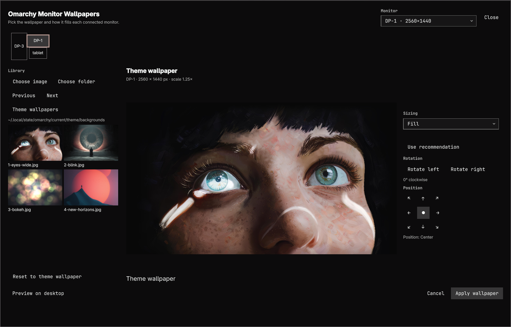
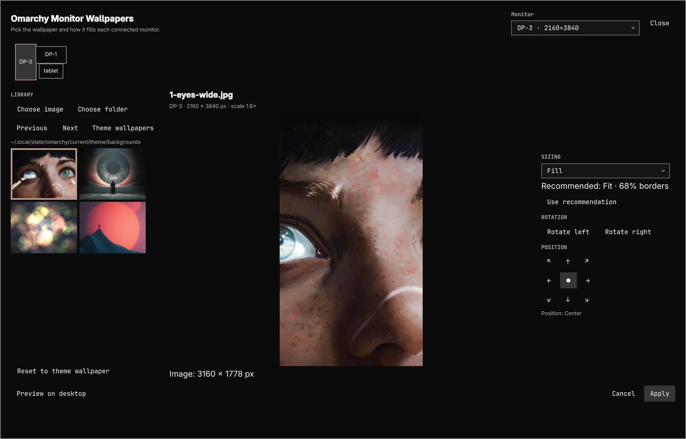

# Omarchy Monitor Wallpapers

**Different wallpapers for every monitor. Native to Omarchy.**

A per-monitor wallpaper manager for **Omarchy, Hyprland, and Quickshell**. Browse your theme's wallpapers, fine-tune fit and rotation, and preview changes on the desktop before saving. No separate wallpaper daemon.

[Install](#install) · [Usage](#usage) · [Sizing modes](#sizing-modes) · [Troubleshooting](#troubleshooting) · [Development](#development)



## Features

- **One image per monitor** — independent settings keyed by connector name.
- **Pixel-accurate sizing** — Fill, Fit, Stretch, Original size, and custom physical-pixel dimensions.
- **Non-destructive adjustment** — 90° image rotation and nine-position alignment; source images remain unchanged.
- **Helpful recommendations** — Fill/Fit suggestions, crop or border percentages, and enlargement warnings.
- **Omarchy wallpaper library** — defaults to the current theme directory; choose your own image or folder when needed.
- **Preview before saving** — in-editor preview plus a reversible, 20-second desktop preview.
- **Native integration** — preserves Omarchy's shared-wallpaper and theme-transition workflow.

> [!IMPORTANT]
> This plugin replaces Omarchy's native background service through its clone mechanism. Do not run it alongside another wallpaper renderer. It requires Omarchy's native shell modules; it is not a standalone Quickshell configuration.

## Install

### Requirements

Omarchy's native Quickshell shell and plugin manager, Hyprland, Python 3, ImageMagick, Zenity, and Git.

```bash
command -v omarchy omarchy-shell hyprctl python3 magick identify zenity git
```

Install any missing dependencies using your normal package-management workflow. The plugin never installs packages automatically. Node.js is needed only for development tests.

### Add and enable

```bash
omarchy plugin add https://github.com/Sohib/omarchy-monitor-wallpapers.git
omarchy plugin enable suhayb.background
```

The stable plugin ID is **`suhayb.background`**. The name shown in Omarchy is **Omarchy Monitor Wallpapers**. Enabling the clone disables its built-in source, `omarchy.background`.

Open the editor:

```bash
omarchy-shell shell summon suhayb.background
```

Or double-left-click an unobstructed desktop background. Double-right-click retains the native theme selector.

> [!NOTE]
> If the same plugin ID is already installed, back up the existing source before replacing it. Do not overwrite an installation containing uncommitted local edits.

## Usage

1. **Select a monitor.** Use the dropdown or monitor-layout overview.
2. **Choose a wallpaper.** Browse the theme library, use Previous/Next, or select a custom image or folder.
3. **Adjust the composition.** Pick sizing, rotate the image, and choose its position. Recommendations are optional and never change your mode automatically.
4. **Preview on desktop.** The editor collapses to a small countdown bar. End the preview to return, or let it expire after 20 seconds.
5. **Apply wallpaper.** Saves only the selected monitor and keeps the editor open for further comparisons.

Cancel, Escape, or closing the editor discards unsaved drafts and clears desktop preview. File pickers temporarily hide the overlay without discarding the draft; cancelling a picker preserves it.

Thumbnail captions show filenames; a checkmark and accent border identify the chosen image. Tab to the gallery, use arrow keys to browse, and press Enter to select. Monitor tiles also support Tab and Enter or Space.

Choose **Reset to theme wallpaper** to clear an independent image and follow Omarchy's shared wallpaper. Sizing and rotation remain available per monitor.

### Wallpaper library

The default directory is:

```text
~/.local/state/omarchy/current/theme/backgrounds
```

Use **Theme wallpapers** to return the library to this directory without changing the selected image.

A saved image outside that directory does not redirect the browser. Explicitly choosing another image or folder changes the browsing location, remembered per monitor for the session. The browser lists readable PNG, JPEG, and WebP files directly inside the folder, sorted by filename. It does not recurse. Unreadable images are marked and skipped by navigation.

### Sizing modes

| Mode | Result |
| --- | --- |
| Fill | Covers the monitor; crops excess image area. |
| Fit | Shows the entire image; adds black borders where needed. |
| Stretch | Fills the monitor without preserving proportions. |
| Original size | Uses the image's intrinsic physical-pixel dimensions. |
| Custom size | Uses independent width and height, each from 1 to 32768 physical pixels. |

Position controls move the image within its canvas, affecting either borders or cropping. Rotation is image-only, clockwise, in 90° steps; monitor rotation, scale, position, and resolution are never changed.

Original/Custom Apply requires verified physical monitor metadata. If unavailable, the UI explains the limitation; Fill, Fit, and Stretch still use screen aspect ratio.

<details>
<summary>Screenshot: portrait monitor and fit recommendation</summary>



</details>

<details>
<summary>Settings, persistence, and cache</summary>

Settings: `~/.config/omarchy/background-editor.json`

```json
{
  "version": 1,
  "monitors": {
    "DP-3": {
      "image": "/home/you/Pictures/portrait.jpg",
      "mode": "fit",
      "rotation": 0,
      "anchorX": 0.5,
      "anchorY": 0.5,
      "widthPx": 2160,
      "heightPx": 3840
    }
  }
}
```

`image: null` follows the shared wallpaper. Connector names are exact identities: disconnected records are retained, but renamed connectors are not automatically matched.

Writes use guarded atomic replacement. Malformed settings retain the last valid in-memory state. External valid edits do not silently discard an open draft: reopen the editor to reload before applying.

Prepared images: `~/.cache/omarchy/wallpaper-editor/`. EXIF orientation is applied before requested rotation. Source files are never modified. Eviction retains 32 recent entries where possible and protects images leased by live frames.

**Legacy migration:** if settings are absent and `~/.config/omarchy/backgrounds/tokyo-night/winding-road-portrait-2160x3840.jpg` is readable, DP-3 uses that existing derivative with Fill and rotation 0. It is never rotated again. Otherwise outputs follow the shared wallpaper and the editor shows a nonblocking notice. Other wallpaper plugins' settings are not imported.

</details>

## Update or remove

For a plugin-manager installation:

```bash
omarchy plugin update suhayb.background
```

Return ownership to the built-in renderer:

```bash
omarchy plugin disable suhayb.background
omarchy-shell shell listPlugins
```

After disabling, remove the installed plugin if desired:

```bash
omarchy plugin remove suhayb.background
```

Source images, settings, cache, and a separate development checkout are independent. Back up settings before intentionally resetting them; never delete source images to uninstall the plugin.

## Troubleshooting

| Problem | Check |
| --- | --- |
| Editor does not open | Confirm the plugin is enabled, validate its folder, then restart the shell. |
| `background editorState` not found | The clone is not loaded, or another renderer owns the IPC target. Check ownership. |
| Image cannot be prepared | Check source readability and the `magick` and `identify` executables. |
| Settings refused | Check JSON/schema, ownership, symlinks, and the 64 KiB size limit. Last-good settings remain in memory. |
| Settings changed externally | Close and reopen the editor. Apply wallpaper stays disabled while the draft is conflicted. |
| Desktop preview not visible | Application windows cover the wallpaper layer. Use an empty workspace to inspect it. |
| Original/Custom disabled | Check physical dimensions, transform, and scale in `hyprctl monitors -j`. |

Useful diagnostics:

```bash
omarchy-shell shell listPlugins
omarchy-shell background editorState
omarchy plugin validate ~/.config/omarchy/plugins/suhayb.background
omarchy restart shell
```

Still stuck? [Open an issue](https://github.com/Sohib/omarchy-monitor-wallpapers/issues) with your Omarchy version, monitor dimensions/scale, and reproduction steps. Remove private paths before sharing logs.

## Development

Keep the Git checkout separate from the installed copy. **Omarchy rejects symlinked plugin folders.**

```bash
mkdir -p ~/Documents/projects
git clone https://github.com/Sohib/omarchy-monitor-wallpapers.git ~/Documents/projects/omarchy-monitor-wallpapers
cd ~/Documents/projects/omarchy-monitor-wallpapers
node --test tests/*.test.js
```

Install into an empty directory, or back up an existing installation first:

```bash
mkdir -p ~/.config/omarchy/plugins/suhayb.background
tar --exclude=.git -cf - . | tar -xf - -C ~/.config/omarchy/plugins/suhayb.background
omarchy plugin validate ~/.config/omarchy/plugins/suhayb.background
omarchy-shell shell rescanPlugins
omarchy plugin enable suhayb.background
omarchy restart shell
```

After `git pull --ff-only` or local source edits, repeat the copy, validation, and restart steps. Checkout edits are not automatically installed.

### Checks

```bash
node --test tests/*.test.js
python3 -m py_compile scripts/editor-io.py
omarchy plugin validate .
```

Image tests require ImageMagick; the EXIF test also requires `exiv2` and skips when unavailable. Tests cover geometry, validation, guarded persistence, image preparation, EXIF/rotation ordering, filename transport, and cache leases. Visual verification on your output layout is still necessary.

| File | Responsibility |
| --- | --- |
| `Background.qml` | Native service, per-monitor state, IPC, transitions, and preview timer. |
| `EditorOverlay.qml` | Editor UI, draft state, and picker lifecycle. |
| `WallpaperFrame.qml` | Shared physical-pixel rendering and image lifecycle. |
| `Model.js` | Pure geometry, recommendation, and validation. |
| `scripts/editor-io.py` | Guarded I/O, image discovery, preparation, and cache. |
| `tests/` | Model and helper behavioral tests. |

Derived from [Omarchy](https://github.com/basecamp/omarchy)'s native `omarchy.background` plugin. The clone provenance and local development history are preserved, along with the [upstream license](LICENSE). Independent customization; not an official Omarchy plugin. Wallpaper artwork shown in screenshots belongs to its respective creators.
